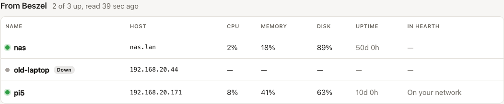

If you monitor your machines with [Beszel](https://beszel.dev), the hub can read the systems it
monitors and list them under **From Beszel** on the Devices page: each system's status, CPU,
memory and root disk use, uptime, and the Hearth device or network host it is. Hearth only reads:
it changes nothing in Beszel and installs nothing on your systems.



## Configure

1. In Beszel, create a user for Hearth. A user with the **read-only** role is enough. It sees the
   systems shared with it, or every system if Beszel's `SHARE_ALL_SYSTEMS` is on.
2. Give the hub the user's email and its password. Pass the password through the environment, or
   through a file only the hub's user can read. Never put it on the command line, where every user
   on the host can see it in `ps`.

```sh
HEARTH_BESZEL_PASSWORD='...' hearth hub --beszel-url http://beszel.lan:8090 --beszel-email hearth@example.com
# or
install -m 600 /dev/null /etc/hearth/beszel.pass   # then write the password into it
hearth hub --beszel-url http://beszel.lan:8090 --beszel-email hearth@example.com \
  --beszel-password-file /etc/hearth/beszel.pass
```

| Flag | Env | |
| --- | --- | --- |
| `--beszel-url` | `HEARTH_BESZEL_URL` | The Beszel hub's web address, e.g. `http://beszel.lan:8090` |
| `--beszel-email` | `HEARTH_BESZEL_EMAIL` | The email of the Beszel user the hub logs in as |
| | `HEARTH_BESZEL_PASSWORD` | Its password |
| `--beszel-password-file` | `HEARTH_BESZEL_PASSWORD_FILE` | A file holding it. The hub refuses a file that group or others can read |

## What the hub reads

Beszel's API is the [PocketBase](https://pocketbase.io/docs/api-records/) API of its hub (see
[Beszel's REST API guide](https://beszel.dev/guide/rest-api)). The hub reads once at start and then
every `--discover-interval` (default 5 minutes). Each read:

1. logs in with `POST /api/collections/users/auth-with-password`, and
2. lists the systems with `GET /api/collections/systems/records`, a page of 200 at a time.

From each system it keeps the name, the host Beszel reaches its agent at, the status (`up`,
`down`, `paused`, `pending`), and from its latest stats the CPU, memory and root disk use in
percent, the uptime and the agent version. Neither the password nor the auth token is logged.

What a read finds is kept in memory only: the hub stores nothing from Beszel, and a restarted hub
shows the systems again after its first read. Beszel keeps the history; open Beszel for charts.

## How systems are matched

Each system is matched to what Hearth already knows, so that a machine is not listed as two
unrelated things:

1. an enrolled device one of whose IP addresses is the system's host, else
2. an enrolled device whose hostname is the system's host or name (case-insensitive; the short
   name, an FQDN and `.local` all match), else
3. a host [on your network](discovery.md) with the system's host as its IP address, or as its
   hostname or name.

Loopback and link-local addresses never match. The **In Hearth** column shows the device, which
opens its drawer, or *On your network*. A system that matches nothing is still listed.

Systems are linked, not merged: Beszel knows no MAC address, which is what network hosts are keyed
by, so a system never becomes a network host of its own, and a machine that is both a network host
and a Beszel system shows in both tables, linked by the **In Hearth** column.

## When there is nothing to show

`GET /api/v1/beszel/systems` always answers 200 with a `status`:

| status | meaning |
| --- | --- |
| `not_configured` | no `--beszel-url`; the Devices page shows no Beszel section |
| `connecting` | the first read has not finished |
| `ok` | the systems follow |
| `unavailable` | the last read failed, for example a wrong password; `error` says why, and the systems of the last good read, if any, follow |
| `standby` | a hub of a [cluster](#in-a-cluster) that does not lead it |

```json
{"status": "ok", "read_at": "2026-11-19T07:45:46Z", "systems": [
  {"id": "a1b2c3d4e5f6g7h", "name": "pi5", "host": "192.168.20.171", "status": "up",
   "cpu": 7.5, "memory": 41.2, "disk": 63, "uptime": 864000, "agent_version": "0.18.0",
   "device_id": "", "device_name": "", "network_mac": "2c:cf:67:12:34:56"}]}
```

## Policy and audit

A read is the hub action `beszel.read` (class `read`, actor `hub/beszel`), one audit entry per
read with `beszel:<url>` as target and the system count and duration in its detail. A policy that
denies the `read` class stops reads before the hub contacts Beszel.

## In a cluster

Only the leader reads Beszel, because only the leader can write the audit entry each read needs.
What it read stays in the leader's memory: open the leader's UI to see the systems. The other
hubs answer `standby` and show a note instead. Set the flags and the password on every hub, so
that a new leader starts reading after a failover. Cluster mode has not been tested with Beszel
yet.
