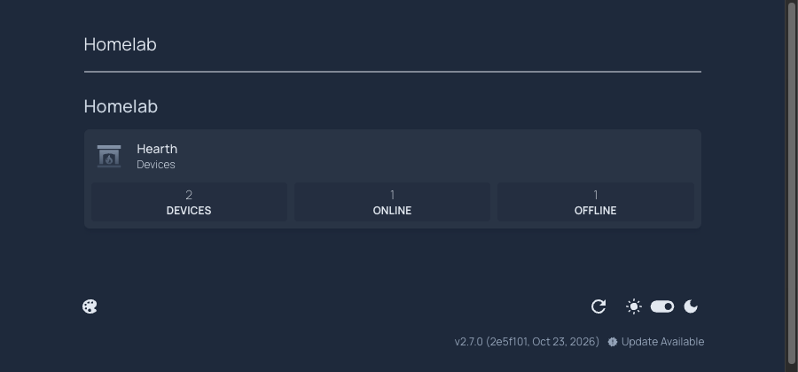

[Homepage](https://gethomepage.dev) reads Hearth through its
[`customapi` widget](https://gethomepage.dev/widgets/services/customapi/). Homepage polls the hub's
dashboard endpoint with a **dashboard token**. The token is read-only: it reads device counts and
states, and nothing else. It cannot open the web UI or the API, MCP, or a panel.



## Create a token

1. In the web UI, open **Panels**. Under **Dashboard tokens**, choose **New token**.
2. Name it (for example `homepage`) and choose how long it lasts.
3. Copy the token, or the ready `services.yaml` entry shown next to it. **It is shown only this
   once.** The hub keeps only a SHA-256 hash of it.

Creating and revoking a token are policy actions (`dashboard.token.create` and
`dashboard.token.revoke`, class `safe`, for a signed-in admin). Both are audited.

## Configure Homepage

Add this to Homepage's `services.yaml`. Put in your hub's address and the token:

```yaml
- Homelab:
    - Hearth:
        icon: mdi-fireplace
        href: http://hearth.lan:7080/
        description: Devices
        widget:
          type: customapi
          url: http://hearth.lan:7080/api/v1/dashboard/summary
          refreshInterval: 30000
          headers:
            Authorization: Bearer <dashboard token>
          mappings:
            - field: counts.total
              label: Devices
              format: number
            - field: counts.online
              label: Online
              format: number
            - field: counts.offline
              label: Offline
              format: number
```

Homepage sends the request from its own server, not from your browser, so the hub's address must be
reachable from the Homepage container. If Homepage runs in Docker on the hub's host, use
`host.docker.internal`, not `localhost`. On Linux, also add
`extra_hosts: ["host.docker.internal:host-gateway"]` to the Homepage container. The screenshot
above is from Homepage v2.7.0, reading a hub over plain HTTP.

## The summary

`GET /api/v1/dashboard/summary` takes the token as `Authorization: Bearer <token>` and nothing else:
a session cookie is not accepted there. It answers:

```json
{
  "version": 1,
  "counts": {"total": 3, "online": 2, "offline": 1},
  "devices": [
    {"id": "5ac2e479…", "name": "pi5", "status": "online", "last_seen": "2026-11-19T19:16:31Z"}
  ],
  "truncated": false
}
```

- `counts` covers every enrolled device. `offline` is every device that is not online, including
  one the hub has not yet heard from.
- `devices` lists at most 200 devices, each with `status` set to `online`, `offline` or `unknown`.
  `truncated` is `true` when some are left out.
- No addresses, facts, labels or secrets, ever.
- The shape stays the same within a `version`. Fields may be added; none are removed or renamed.

To show one device instead, map a field such as `devices.0.status`.

## Policy and audit

Every read is a policy decision. The actor is `dashboard`, with ID `token/<token id>`, the action is
`dashboard.read`, and the class is `read`. To turn dashboards off, set this in `policy.yaml` (see
[Guardrails](guardrails.md)):

```yaml
actors:
  dashboard:
    read: deny
```

A dashboard read is never held for approval: `confirm` refuses it.

Homepage polls every few seconds. So the audit log does not get a row for every read:

- It gets one row for a token's first read in each hour. That row's `reads_unaudited` counts the
  reads since the previous row.
- A refused read (no token, an unknown, revoked or expired token, or one denied by policy) is
  audited as `deny`, with the reason. To keep a forgotten Homepage from flooding the log, this
  happens at most once an hour for each source address and token, and `denials_unaudited` counts
  the others.

These counts are kept by each hub process, so a hub restart starts them again.

Reads are rate-limited per token: a burst of 20, then one a second. Past that, the hub answers
`429` with `Retry-After`.

## Revoke

Choose **Revoke** next to the token under **Panels → Dashboard tokens**. The next read gets `401`,
and Homepage shows an error on the card. A revoked token cannot be brought back. Create a new one.
