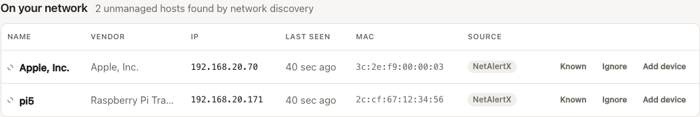

If you run [NetAlertX](https://netalertx.com), it already keeps a list of every device on your
network, with names you may have given them. The hub can import that list and merge it with what
[network discovery](discovery.md) and [Pi-hole](pihole.md) find. Devices NetAlertX knows then
appear under **On your network**, with a **NetAlertX** source badge, even on VLANs the hub does
not scan. Hearth only reads: it changes nothing in NetAlertX.



Import works with or without `--discover-subnet`.

## Configure

1. In NetAlertX's settings, copy the API token (the `API_TOKEN` setting) and note the API port
   (`GRAPHQL_PORT`, 20212 by default).
2. Give the token to the hub through the environment, or through a file only the hub's user can
   read. Never put it on the command line, where every user on the host can see it in `ps`.

```sh
HEARTH_NETALERTX_TOKEN='...' hearth hub --netalertx-url http://netalertx.lan:20212
# or
install -m 600 /dev/null /etc/hearth/netalertx.token   # then write the token into it
hearth hub --netalertx-url http://netalertx.lan:20212 --netalertx-token-file /etc/hearth/netalertx.token
```

| Flag | Env | |
| --- | --- | --- |
| `--netalertx-url` | `HEARTH_NETALERTX_URL` | The NetAlertX API server (port `GRAPHQL_PORT`), e.g. `http://netalertx.lan:20212` |
| | `HEARTH_NETALERTX_TOKEN` | The API token |
| `--netalertx-token-file` | `HEARTH_NETALERTX_TOKEN_FILE` | A file holding it. The hub refuses a file that group or others can read |

The token is required: NetAlertX refuses API requests without one.

## What the hub reads

On each import the hub sends one request, `GET /devices`, with the token in an
`Authorization: Bearer` header (never in the URL). See the
[NetAlertX API docs](https://docs.netalertx.com/API/) and its
[devices endpoint](https://docs.netalertx.com/API_DEVICES/). From each device it takes:

- the MAC address (`devMac`) and last IP address (`devLastIP`, else `devPrimaryIPv4`);
- the name (`devName`), unless it is one of NetAlertX's placeholders such as `(unknown)` or
  `(name not found)`, so that a placeholder never replaces a name a scan found;
- the vendor (`devVendor`);
- whether NetAlertX saw it in its last scan (`devPresentLastScan`).

Archived devices are skipped, and so is NetAlertX's `Internet` node, which is not a host. The
token is never logged, and the hub does not follow redirects, which could carry it to another
host. An import fails if NetAlertX lists more than 4096 devices, the most
the hub imports from any one source.

A device NetAlertX saw in its last scan counts as seen at the time of the import, so it updates a
known host's IP and *Last seen*. Hearth does not use NetAlertX's own timestamps, because their time
zone depends on NetAlertX's version and settings. A device that was absent from NetAlertX's last
scan adds the host and its name, but does not change a known host's IP or *Last seen*.

## How hosts are merged

NetAlertX is one more import source next to Pi-hole and DHCP lease files, and follows the same
rules (see [How hosts are merged](pihole.md#how-hosts-are-merged)):

- Imports run once at start and then every `--discover-interval` (default 5 minutes).
- Hosts are matched by MAC address, so a device NetAlertX, Pi-hole and a scan all know is listed
  once, with every source as a badge. The API lists `netalertx` in the host's `sources`.
- A DHCP lease's name wins over a NetAlertX name, which wins over an mDNS or reverse DNS name.
- An import publishes no events. A host only NetAlertX knows never fires a
  [new-device alert](discovery.md#new-device-alerts); NetAlertX has its own alerts for that.
- A NetAlertX that is down or refuses the token is logged and skipped; the other sources are still
  imported.

## Policy and audit

An import is the hub action `network.import` (class `read`, actor `hub/discovery`), one audit
entry per import with `netalertx:<url>` among its targets. A policy that denies the `read` class
stops imports.

## In a cluster

Only the leader imports, and the result is replicated to every hub. Set the flags and the token
on every hub, so that a new leader keeps importing after a failover.
