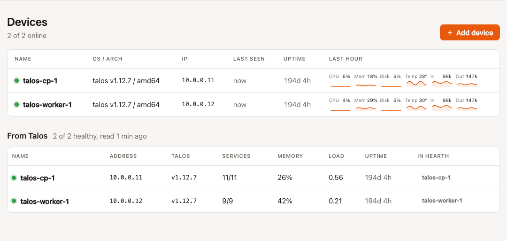

[Talos Linux](https://www.talos.dev) has no shell and no package manager, so the usual one-line agent
install cannot run on it. Hearth covers a Talos node in two ways, which work alone or together:

- **The Talos API.** The hub reads each node through a talosconfig: its Talos version, its system
  services and their health, memory, load and boot time. They show under **From Talos** on the
  Devices page. The hub only reads: it never upgrades, reboots, resets or reconfigures a node.
- **The agent DaemonSet.** A Hearth agent runs in a pod on every node and reports the node, not the
  pod, as a device: its host facts (Talos version, kernel, CPU, memory, disks, interfaces) and its
  metrics (CPU, memory, disk, temperature, network). The node is then a device like any other, with
  charts, automations and alerts.

With both, each **From Talos** row links to the node's device, matched by the address the node is
read at, then by its hostname. A node is never added as a second device, and the
[Kubernetes](kubernetes.md) node links to the same device.



## Read nodes through the Talos API

Give the hub a talosconfig:

```sh
hearth hub --talosconfig /etc/hearth/talosconfig
```

| Flag | Env | |
| --- | --- | --- |
| `--talosconfig` | `HEARTH_TALOSCONFIG` | The talosconfig file. Keep it readable by the hub's user only |
| `--talos-context` | `HEARTH_TALOS_CONTEXT` | The context to use; by default the file's current one |
| `--talos-nodes` | `HEARTH_TALOS_NODES` | The nodes to read, comma-separated, instead of the context's `nodes` |

The hub connects to the context's first endpoint that answers (port 50000 unless the endpoint names
one) with the context's client certificate, and verifies the endpoint against the context's CA. It
reads every node of the context through that endpoint, as `talosctl -n` does; a context without
`nodes` reads its endpoints. List every node with `--talos-nodes` when the context names only some,
or names an old address.

A read-only talosconfig is enough, and is the one to give the hub. On a machine with an admin
talosconfig, make one with the `os:reader` role:

```sh
talosctl config new --roles os:reader /etc/hearth/talosconfig
```

Hearth never needs more: its Talos client can call only `Version`, `Hostname`, `ServiceList`,
`Memory`, `LoadAvg` and `SystemStat`, whatever the talosconfig allows.

### What the hub reads

The hub reads once at start and then every `--discover-interval` (default 5 minutes). For each node:

| Shown | From |
| --- | --- |
| Name | `Hostname` |
| Talos | `Version`: the Talos tag, architecture and platform |
| Services | `ServiceList`: how many are running and pass their health check, and the ones that do not |
| Memory | `Memory`: the share of memory not available |
| Load | `LoadAvg`: the 1-minute load average |
| Uptime | `SystemStat`: the boot time |

A node is **healthy** when every service is running and none fails its health check (a service
without one, such as `dashboard`, counts as healthy). A node the endpoint cannot reach shows as
unreachable with the reason, and the other nodes still show. When the endpoint itself does not answer,
the table keeps the last read and says why it failed.

`GET /api/v1/talos/nodes` returns the same, for a signed-in session:

```json
{"status": "ok", "read_at": "2026-11-20T00:13:55Z", "nodes": [
  {"address": "192.0.2.10", "hostname": "talos-cp-1", "version": "v1.12.7", "arch": "amd64",
   "platform": "metal", "healthy": true,
   "services": [{"id": "etcd", "state": "Running", "health": "healthy"}],
   "mem_total": 16532217856, "mem_available": 12242636800, "load1": 0.56, "load5": 0.75,
   "load15": 0.64, "boot_time": "2026-05-09T18:24:36Z",
   "device_id": "31c4726081e29a0766c8", "device_name": "talos-cp-1"}]}
```

### Policy and audit

A read is the hub action `talos.read` (class `read`, actor `hub/talos`), one audit entry per read with
`<context>@<endpoint>` as target and the node count, the unreachable count and the duration in its
detail. A policy that denies the `read` class stops reads before the hub contacts the Talos API. The
talosconfig's key never appears in the audit log, the hub log or the API.

A runbook's [`talos_node` check](runbooks.md#a-talos-node-runs-a-version) reads through the same client
and is decided as `talos.read` too, with the runbook as actor (`automation`, `runbook/<id>`) and the
node as target: one entry per attempt at the step.

### In a cluster

Every master reads on its own, with an audit entry per read, and its UI shows the nodes it read.
Give every master the same flags and talosconfig.

## Run the agent as a DaemonSet

[`deploy/kubernetes/agent-daemonset.yaml`](https://github.com/gvart/hearth/blob/main/deploy/kubernetes/agent-daemonset.yaml)
runs one agent per node, control planes included. It works on any Kubernetes, not only Talos.

1. Edit the manifest: set `HEARTH_HUB_URL` to the hub's agent URL (`https://<hub>:7443`, a name or
   address in the hub's certificate) and the image tag to the hub's version. The image must be the
   first Hearth release that ships this manifest, or a later one: older images lack
   `hearth agent join --token-file`. The tag in the file is a placeholder.
2. Enrollment tokens are single-use, so create one per node and put them in a Secret keyed by node
   name. On the hub host:

   ```sh
   mkdir -m 700 tokens
   for n in $(kubectl get nodes -o name | cut -d/ -f2); do
     hearth token create --ttl 1h | sed -n 2p | tr -d ' ' > "tokens/$n"
   done
   kubectl apply -f agent-daemonset.yaml
   kubectl -n hearth create secret generic hearth-agent-tokens --from-file=tokens/
   rm -r tokens
   ```

3. Each pod enrolls its node within seconds: the nodes appear on the Devices page under their
   hostnames.
4. Once every node is there, delete the Secret. Every pod mounts every node's token, and an enrolled
   node never needs one again: the Secret volume is optional, so a restarted pod starts without it.

   ```sh
   kubectl -n hearth delete secret hearth-agent-tokens
   ```

How it works:

- **The node, not the pod.** The pod uses the node's network (`hostNetwork`), so the device has the
  node's hostname and addresses. The host's `/proc` and `/sys` are mounted read-only and named by
  `HOST_PROC` and `HOST_SYS`, and its `/etc/os-release` by `HOST_ETC`, so facts and metrics are the
  node's.
- **Enrollment.** An init container runs `hearth agent join --if-not-enrolled
  --token-file /etc/hearth-tokens/$(NODE_NAME)`, with the node name from the downward API. The
  identity is kept on the node in `/var/lib/hearth-agent` (writable on Talos), so a restarted or
  updated pod is the same device and needs no new token. A node added later needs its own token:
  create the Secret again with that node's token. Until then the join of that node fails, and its pod
  retries.
- **Only reads.** The agent runs with an empty capability ceiling: no `--allow-exec`,
  `--allow-restart`, `--allow-logs` or `--allow-shell`, and with `--local-ceiling`, so the
  Capabilities set on the hub cannot raise it and the hub can run nothing on the node through it. All Linux capabilities are dropped, the root filesystem is read-only, privilege escalation is
  off, and the pod gets no service account token. It runs as root only to write its identity to the
  root-owned host directory. It does not use the host's PID namespace.
- **Small.** Requests are 10m CPU and 16 MiB, limits 100m and 64 MiB. On a two-node Talos cluster each
  agent used about 4 MiB and 1m CPU.

Disks: the agent lists the node's mounts, but sizes them from inside the pod, where `/` is the
container's own filesystem. On Talos that is the `/var` partition, so the disk metric is the node's
`/var` use, which is the disk that fills on Talos, and the `/` fact shows the size of `/var` too.

## Upgrades

The Talos integration only reads. To upgrade a node, use the
[upgrade recipe](runbook-recipes.md#upgrade-a-talos-node): a runbook that checks cluster health and
etcd quorum, asks for approval, runs `talosctl upgrade --preserve` from a device with an agent, checks
through this integration that the node runs the new version with every service healthy, waits for the
node to be Ready again, and rolls back with `talosctl rollback`. Never roll back a node that
did not reboot into the new version: `talosctl rollback` would boot the version before the current one. Its `talosctl` steps are
`exec` actions, which are dangerous, so they go through policy and approval like any other.

**The recipe has not been run on real hardware yet.** It is checked by unit tests only. Try it on a
spare node first.
