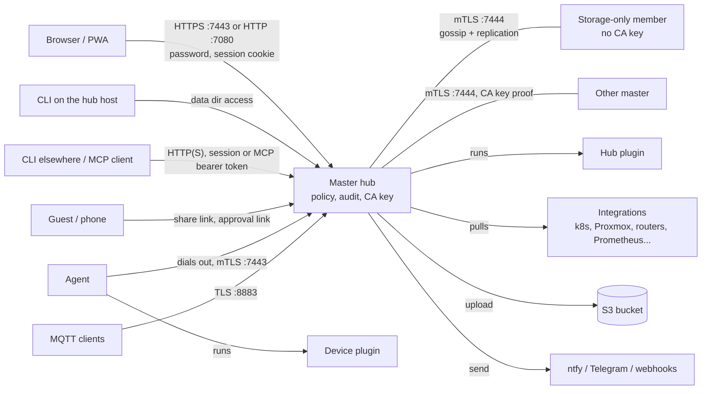

This page is the starting point for a security review of Hearth (see
[#83](https://github.com/gvart/hearth/issues/83)). It describes the system as of **v0.0.1-rc.12**: it
lists what an attacker would want, the boundaries they would have to cross, what stops them at each one
today, and what is known not to. Every mitigation here is something the code does now. Each one names
the doc that explains it and the code that does it. The rules themselves are in the
[security model](security.md); this page does not repeat them in full.

## Assets

| Asset | Where it lives | Why it matters |
| --- | --- | --- |
| Hub CA private key | `ca.key` (0600) in each master's data dir; inside a backup archive when an admin chooses | Whoever holds it can mint certificates every agent and hub trusts, and unseal stored credentials |
| Devices | every enrolled host | Agents can run commands, restart services, open a terminal, control containers and run plugins, within each device's ceiling |
| Admin password and sessions | argon2id hash and session rows on masters | Full control of the UI and API |
| MCP tokens, dashboard tokens, panel share links, approval links | SHA-256 hashes in the store | Bearer credentials, each with a narrow scope |
| Enrollment and join tokens | hashed in the store, plus an owner record in the creating master's data dir | Enrol a device; a hub-eligible token or a master join token leads to the CA key |
| Integration credentials | kubeconfigs, Proxmox, ESPHome, OpenWrt, OPNsense, UniFi, notification channels: sealed in the store. Pi-hole, Beszel, Talos, MQTT bridge: files on the hub host | Access to the systems Hearth adopts |
| Configuration documents | policy, automations, runbooks, notifications in the replicated store | Decide what is allowed and what runs automatically |
| Audit log | sharded rows in the store, spooled in `audit-spool` while replicas are down | The record of every decision |
| Backups | `.hbk` files, local or in an S3 bucket | Hold every credential of the hub, and the CA key unless left out |

## Trust boundaries

The boundaries, from the outside in:

1. **Browser and web UI.** An untrusted network and an untrusted browser on one side, the hub's API on
   the other.
2. **CLI.** Two kinds. Admin commands on the hub host trust whoever can read the data dir. Commands
   that talk to a hub over its API (`hearth device upgrade --hub-url`, `hearth mcp`) authenticate like
   the web UI or an MCP client.
3. **MCP clients.** An AI assistant with a bearer token. Its requests are treated as untrusted input.
4. **Masters.** They hold the CA key, decide policy, write the audit log and hold agent streams.
5. **Storage-only members.** Replicas of a share of the store. They do not hold the CA key and are
   trusted less than masters.
6. **Agents.** Each device runs one. It trusts the hub CA and enforces its own ceiling. The hub trusts
   only what the agent's certificate proves.
7. **Plugins.** Hub plugins run as the hub's user. Device plugins run as the agent's user.
8. **Integrations.** Systems the hub pulls from with credentials it stores. Their answers are untrusted
   input.
9. **MQTT.** Sensors and scripts on the LAN, over TLS, with a certificate or a password.
10. **Backups and S3.** An encrypted archive that leaves the hub, on someone else's disk.
11. **Outbound notifications and webhooks.** Third-party services that receive what the hub sends.
12. **Release pipeline.** GitHub releases, which agents install on a remote upgrade.

## Attackers

| Attacker | Has | Wants |
| --- | --- | --- |
| **LAN attacker** | a host on the same network: can sniff, spoof ARP and mDNS, and reach the hub's ports | the admin session, a device enrolled under their control, or commands on devices |
| **Malicious web page** | the admin's browser, visiting it while signed in | to make that browser act on the hub (CSRF), or read from the hub |
| **Stolen bearer credential** | an MCP token, a dashboard token, a share link or an approval link | to do more than that credential allows |
| **Misbehaving AI assistant** | a valid MCP token, possibly fed hostile input (prompt injection through logs or device names) | to run dangerous actions |
| **Compromised device** | root on an enrolled device, its agent certificate and key | to reach other devices, the hub or the CA key |
| **Compromised storage-only member** | root on a hub that is not a master: a hub node certificate, its copy of the sharded rows | to gain master powers or the CA key, or to change what masters decide |
| **Compromised master** | the CA key | everything. Out of scope: see [Not defended](#not-defended) |
| **Hostile integration or network host** | control of what an integration or a discovered host answers | to inject data that makes the hub act, or crash it |
| **Bucket or channel provider** | the S3 bucket, or the ntfy or Telegram server | the hub's credentials, or to approve held actions |
| **Supply chain** | write access to GitHub release assets, without the release signing key | to make agents install their code |

## Threats and mitigations, per boundary

The letters are STRIDE: **S**poofing, **T**ampering, **R**epudiation, **I**nformation disclosure,
**D**enial of service, **E**levation of privilege.

### 1. Browser and web UI

| | Threat | Mitigation | Reference |
| --- | --- | --- | --- |
| S | Guessing the admin password | 5 attempts in a row per client address, then one every 12 s; argon2id hash | [security.md](security.md#the-web-ui), `internal/hub/loginlimit.go`, `internal/hub/password.go` |
| S | Reusing a stolen session for the most sensitive actions | Revoking a device, tokens, policy, notification channels, backups, Add hub, agent upgrades, ceiling raises and CA rotation ask for the password again (5 minutes, per session, in memory) | [security.md](security.md#sensitive-actions-ask-for-the-password-again), `internal/hub/reauth.go` |
| T | Cross-site request forgery | Session cookie is `HttpOnly` and `SameSite=Strict`; request bodies must be `application/json` | `internal/hub/api.go`, `internal/hub/webadmin.go` (`decodeJSON`) |
| I | Sniffing the password or cookie | HTTPS on 7443 with the hub CA, `Secure` cookie over TLS. Plain HTTP on 7080 stays open: see residual risks | [https.md](https.md) |
| I | Terminal traffic over plain HTTP | Terminals are served only over HTTPS and only to the hub's own page (`Origin` host check). No flag turns this off | [terminal.md](terminal.md#https-only), `internal/hub/shell.go` |
| D | Many logins starving the hub of CPU | One password check at a time, in a child process at the lowest CPU priority; `503 busy` after 10 s | [security.md](security.md#the-web-ui), `internal/hub/verifychild.go` |
| E | Acting beyond policy from the UI | Every action goes through the policy engine; unknown actions are refused | [guardrails.md](guardrails.md), `internal/policy/engine.go` |
| R | Denying an action took place | Each decision, allow or deny, is audited before the action runs; a master that cannot place the entry refuses the action | [cluster.md](cluster.md#policy-and-audit), `internal/policy/spool.go` |

Guest pages have their own row: **panel share links** open one panel and its allowed restarts, with
rate limits, and are stored as hashes ([panels.md](panels.md)). **Approval links** can only deny, once,
before the approval expires. Approving takes a sign-in and the password
([guardrails.md](guardrails.md#approve-from-your-phone), `internal/hub/approvallinks.go`).

### 2. CLI

| | Threat | Mitigation | Reference |
| --- | --- | --- | --- |
| E | A local user reading tokens from process lists | Enrollment tokens are passed in `HEARTH_TOKEN` or on stdin, never in argv | [security.md](security.md#enrollment-tokens) |
| E | Running admin commands on a storage-only member to write global rows | Admin commands refuse to run on a storage-only member's host before anything is written | [cluster.md](cluster.md#who-may-write-what) |
| S | A forgotten password locking the owner out | `hearth admin set-password` on the hub host, by design CLI-only | [security.md](security.md#sensitive-actions-ask-for-the-password-again) |

Admin commands on a hub host trust whoever can read its data dir. That data dir is as sensitive as the
CA key.

### 3. MCP clients

| | Threat | Mitigation | Reference |
| --- | --- | --- | --- |
| S | A forged or revoked token | Each client has its own token, stored as a SHA-256 hash and checked on every request on the master's own copy | [mcp.md](mcp.md#tokens), [cluster.md](cluster.md#who-may-write-what) |
| E | An assistant asking for more than it was given | The token's scope (`read`, `safe`, `dangerous`) caps the class; tools beyond it are not offered, and requests beyond it are denied and audited | [mcp.md](mcp.md#tokens), `internal/mcpserver/server.go` |
| E | Prompt injection leading to a dangerous action | Dangerous MCP requests are held for approval by default. Approving takes the admin password | [mcp.md](mcp.md#approvals) |
| E | Upgrading agents through MCP | `device.upgrade` is never available to an automation or an MCP client | [security.md](security.md#remote-agent-upgrades) |
| I | Token sniffed on plain HTTP | Documented; HTTPS on 7443 is the advice | [mcp.md](mcp.md#connecting-claude-code) |

### 4. Masters

| | Threat | Mitigation | Reference |
| --- | --- | --- | --- |
| I | CA key leaving a master | Stays in the data dir (0600). It leaves only over the pinned mTLS join channel to a joining master, over `FetchCAKey` during an audited promotion or rotation, or inside a passphrase-encrypted backup. Never in the store, replication, a snapshot or gossip | [security.md](security.md#identities-and-certificates), `internal/cluster/join.go`, `internal/cluster/apcakey.go` |
| E | A hub-eligible enrollment token used to become a master | Creating one takes the password again. The minted join token is bound to the device, valid 15 min, capped at 3 masters and 5 storage members, and re-checked at the join | [security.md](security.md#identities-and-certificates), [design/auto-hubs.md](design/auto-hubs.md) |
| T | Split brain running a dangerous action on a cut-off side | A master that reaches no other member for 60 s refuses dangerous actions, enrollments and joins | [cluster.md](cluster.md#guarantees) |
| S | A revoked credential used on a cut-off master | Revocations are critical writes, announced on gossip at once; at most 60 s, then only safe actions | [cluster.md](cluster.md#guarantees) |
| T | Double-spending a single-use token across masters | Tokens and approvals have an owner master that alone consumes or decides them, from its own record | [cluster.md](cluster.md#masters), `internal/cluster/owned.go` |
| S | Old CA used after a suspected leak | CA rotation pins existing hub certificates, renews agents only for their recorded certificate and key, and drops the old CA at the finish | [security.md](security.md#rotating-the-hub-ca), `internal/pki/rotate.go` |

### 5. Between hubs: masters and storage-only members

| | Threat | Mitigation | Reference |
| --- | --- | --- | --- |
| S | A non-hub joining the gossip | Gossip and replication use mTLS with hub node certificates of the cluster's CA; device certificates, other CAs and revoked hub certificates are refused. A member's name is bound to its certificate by a handshake the hub made itself | [cluster.md](cluster.md#ports-and-names), `internal/cluster/gossiptransport.go` |
| E | A member claiming the master role on the gossip | Roles on the gossip decide nothing. A peer proves it is a master by signing the connection's TLS exporter with the CA key. Global rows, `apply` and master-to-master calls are taken only from a peer that proved it | [cluster.md](cluster.md#who-may-write-what), `internal/cluster/replauth.go` |
| I | A storage member reading or forging sessions and tokens | Sessions, MCP and dashboard tokens, panels and share links live on masters only, sent only to a peer that proved the key. Reads from an unproven peer run under an SQLite authorizer that excludes them | [cluster.md](cluster.md#who-may-write-what), `internal/cluster/mastertables.go` |
| E | A storage member minting a master join token | The owner master acts on its own record, not the row; what a token grants comes from the record | [cluster.md](cluster.md#who-may-write-what), `internal/cluster/owned.go` |
| T | A storage member rewriting sharded rows | **Not mitigated yet**: see residual risks ([#387](https://github.com/gvart/hearth/issues/387)) | [cluster.md](cluster.md#who-may-write-what) |

### 6. Agents and devices

| | Threat | Mitigation | Reference |
| --- | --- | --- | --- |
| S | Enrolling with a stolen or replayed token | Single use, 15 min by default (24 h max from the UI), stored hashed, revocable until used | [security.md](security.md#enrollment-tokens), `internal/pki/token.go` |
| S | An impostor hub collecting tokens | The token carries the hub CA fingerprint; the agent checks it before sending the token | [security.md](security.md#enrollment-tokens), `internal/pki/pin.go` |
| E | A hub, even a compromised one, running anything on a device | The agent runs only what its ceiling allows, nothing by default; it checks every pushed ceiling and every request itself. `--local-ceiling` makes the hub unable to raise it | [guardrails.md](guardrails.md#device-capability-ceiling), `internal/agent/ceiling.go` |
| E | A hub making an agent install arbitrary code | The hub names a release version only. The agent builds the URLs itself and checks an Ed25519 signature with a compiled-in key, then the SHA-256 and the version. No downgrades | [security.md](security.md#remote-agent-upgrades), `internal/agent/upgrade.go`, `internal/release/key.go` |
| E | A compromised device reaching other devices | Agents dial out and open no ports. A device certificate is refused on the cluster port. Commands go to a device only through policy on a master | [security.md](security.md#rules) |
| S | A revoked device reconnecting | Certificates are revoked, the agent is disconnected within 10 s. But see [#387](https://github.com/gvart/hearth/issues/387) for the read path | [security.md](security.md#revoking-an-enrollment-token) |
| T | Shell injection through command arguments | Commands are a program plus arguments run with `exec`, never a shell | [automations.md](automations.md#actions-on-devices-and-webhooks) |

### 7. Plugins

| | Threat | Mitigation | Reference |
| --- | --- | --- | --- |
| E | Another local user swapping a hub plugin's program, manifest or script | The hub refuses each of them, and every directory above, unless owned by the hub's user or root and not writable by others; checked before every start | [plugins.md](plugins.md#who-may-change-a-plugin), `internal/plugins/trust_unix.go` |
| R | Not knowing what ran | Every hub plugin start is the audited `plugin.start` with the program's real path and SHA-256 | [plugins.md](plugins.md#isolation) |
| E | A device plugin release swapped after approval | A grant pins a release digest (program + manifest); the agent checks the SHA-256 before keeping it and before every start | [security.md](security.md#plugins-on-devices), `internal/plugins/device.go` |
| D | A plugin flooding or hanging the hub | Line and rate limits, ping timeouts, restart with backoff, 32 commands in flight | [plugins.md](plugins.md#isolation) |

A plugin grant is arbitrary code as the agent's (or hub's) user, whatever its class. The class limits
what the hub may ask, not what the program does.

### 8. Integrations and discovery

| | Threat | Mitigation | Reference |
| --- | --- | --- | --- |
| I | Leaking integration credentials from the database | Kubeconfigs, Proxmox, ESPHome, OpenWrt, OPNsense, UniFi and notification credentials are sealed with AES-256-GCM, never logged, served or audited | [security.md](security.md#integrations), `internal/store/carotation.go`, `internal/hubconfig/docs.go` |
| E | A kubeconfig running programs on the hub | `exec` and `auth-provider` credential plugins and `tokenFile` are refused | [kubernetes.md](kubernetes.md) |
| S | A man in the middle on an integration | Proxmox, OPNsense and UniFi verify TLS against a CA, a pinned fingerprint or system roots. OpenWrt over plain http sends the password in the clear (documented) | [security.md](security.md#integrations) |
| E | Over-privileged integration accounts | Read-only by default; each write is a policy decision. The account's own role on the remote system is the ceiling (read-only talosconfig, Beszel read-only user) | [talos.md](talos.md), [beszel.md](beszel.md) |
| T | Spoofed ARP, mDNS or DHCP data | Discovery data only names and classifies hosts. Adding an agent to one still takes an enrollment token. See questions for the reviewer | [discovery.md](discovery.md) |

### 9. MQTT broker

| | Threat | Mitigation | Reference |
| --- | --- | --- | --- |
| S | Anonymous or spoofed clients | TLS only, no plain-text port. A client authenticates with a device certificate (checked against issuance and revocation, again every 30 s) or a bcrypt-hashed password. No anonymous access | [mqtt.md](mqtt.md), `internal/mqtt/auth.go` |
| E | Reading or writing topics not granted | Deny-by-default topic ACLs per user and device, checked on subscribe, publish and delivery; client IDs are bound to their owner | [mqtt.md](mqtt.md#topic-rules), `internal/mqtt/acl.go` |
| E | A writable clients file granting any topic | The hub refuses to start if group or others can write it | [mqtt.md](mqtt.md#turn-it-on) |
| I | Bridge credentials leaking | No password in the bridge file; password file and key must be private; the remote certificate is always checked | [mqtt.md](mqtt.md#bridge-to-another-broker) |
| D | Packet floods | 256 KiB packet limit, one password check at a time with a bounded queue | [mqtt.md](mqtt.md#limits) |

### 10. Backups and S3

| | Threat | Mitigation | Reference |
| --- | --- | --- | --- |
| I | A bucket provider reading the hub's credentials | Every backup is encrypted with AES-256-GCM under an Argon2id key from a passphrase of 12+ characters, which never goes to the bucket. Scheduled backups leave the CA key out unless `--backup-include-ca` | [backup.md](backup.md#the-passphrase), [backup.md](backup.md#the-ca-key-stays-out-by-default), `internal/backup/crypt.go` |
| T | A changed or truncated archive restored | Authenticated encryption: any change makes the restore fail | [backup.md](backup.md#the-passphrase) |
| E | Taking a backup to steal the CA key | `hub.backup` is a policy action, audited, with the password again in the web UI | [security.md](security.md#identities-and-certificates) |
| T | Pruning deleting other objects | Deletes only keys matching the hub's own naming under the prefix | [backup.md](backup.md#what-the-hub-does), `internal/s3/client.go` |

### 11. Notifications and webhooks

| | Threat | Mitigation | Reference |
| --- | --- | --- | --- |
| I | Webhook URLs and headers leaking secrets | Errors and the audit log name only the scheme and host | [automations.md](automations.md#actions-on-devices-and-webhooks) |
| E | A notification channel reader approving held actions | Approval links can only deny; the secret is in the URL fragment, single-use, expiring with the approval | [guardrails.md](guardrails.md#approve-from-your-phone) |
| I | Telemetry leaking lab details | Off by default; when on, a fixed set of coarse fields and a random install ID | [telemetry.md](telemetry.md), `internal/telemetry/telemetry.go` |

### 12. Release pipeline

| | Threat | Mitigation | Reference |
| --- | --- | --- | --- |
| T | Changed release assets on GitHub | Agents trust only the Ed25519 signature of `checksums.txt`, made in a separate job with an approval-gated secret. `install.sh` checks the Sigstore signature when cosign is present, and the SHA-256 always | [security.md](security.md#the-installer-and-releases), `internal/release/sign.go` |
| T | Tampered `install.sh` on the LAN | The agent still pins the hub CA from the token. Documented: download and check the installer yourself if that matters | [security.md](security.md#the-installer-and-releases) |

## Known residual risks

Open issues and documented gaps, as of v0.0.1-rc.12:

- **A compromised storage-only member can rewrite the sharded rows it holds**
  ([#387](https://github.com/gvart/hearth/issues/387)): it can answer "not revoked" for a revoked
  device certificate, change which step of a runbook run comes next, hide, change or invent audit
  entries, and mislead the devices list and run history of its buckets. Until signed row versions land,
  run storage-only members only on hosts you trust as much as masters.
- **Leftovers of masters-only tables** ([#389](https://github.com/gvart/hearth/issues/389)): edge cases
  of share-link revocation on a master that missed the panel, and untested branches.
- **No Byzantine tolerance between hubs.** The cluster tolerates crashes and splits, not lying members.
  A compromised master is a full compromise ([cluster.md](cluster.md#design-notes)).
- **A removed master's data dir keeps the CA key** until the CA is rotated
  ([cluster.md](cluster.md#limits)).
- **Plain HTTP on port 7080.** The password, the session cookie, MCP tokens and share links cross the LAN
  in the clear when used over it, and the installer is served over it. HTTPS needs the hub CA trusted
  on each device.
- **The hub-eligible token mint is not policy-controlled.** A hub-eligible token not yet used still
  mints a join token after the policy changes. Revoke it instead
  ([security.md](security.md#identities-and-certificates)).
- **Device plugins.** Any enrolled device can fetch any plugin's program and manifest. After a
  re-upload, a restarted agent stops running the plugin until its grant moves to the new release
  ([security.md](security.md#plugins-on-devices)).
- **Host CLI on a cut-off master.** `hearth token create` and `hearth cluster token create` on a host
  are not refused when that master is cut off ([cluster.md](cluster.md#limits)).
- **Bearer links.** Panel share links and approval links are credentials anyone holding them can use
  within their scope.
- **MQTT traffic is not audited.** The clients file is the rule; refused connections are logged.
- **Credentials kept as files.** The Pi-hole, Beszel and MQTT bridge passwords and the talosconfig are
  files on the hub host (permission-checked where the docs say so), not sealed in the store.
- **Automation and runbook files are stored as written**, not sealed. Secrets in them are readable by
  anyone with the store.
- **Outbound requests are not restricted.** A webhook action or a check can reach any address the hub
  can, LAN included. Writing automations is an admin or a `dangerous`-scope MCP action.
- **One admin account.** No users, no roles, no second factor.
- **Upgrade rollback by network.** Whoever keeps an upgraded agent from every hub for 5 minutes makes it
  go back to the previous release, never an older one
  ([security.md](security.md#remote-agent-upgrades)).
- **Agent upgrades do not check the Sigstore bundle**, only the Ed25519 release signature.

## Not defended

- **Root on a master, or read access to its data dir.** That is the CA key and every credential.
- **Root on a device**, for that device: the agent's key, its ceiling and anything it may run.
- **A malicious plugin you allowed**: it runs as the hub's or agent's user.
- **The maintainer's release signing key** being stolen together with GitHub release access.

## Questions for the reviewer

These have not been analysed in depth yet and are where outside eyes help most:

1. **CSRF and cross-origin reads.** Confirm every state-changing endpoint requires a JSON body or
   another non-simple request, and that no endpoint answers cross-origin reads it should not
   (`internal/hub/api.go`, `internal/hub/webadmin.go`).
2. **Discovery input.** Hostnames, mDNS services and vendors come from the network. Check how they are
   stored, rendered in the UI, and used in templates and classification (`internal/discovery/`).
3. **Prompt injection through MCP.** Logs, device names and facts reach an assistant. Check whether any
   tool can be steered into an action the token's scope and the approval flow would not catch
   (`internal/mcpserver/`).
4. **Enrollment and PKI.** Token format, hashing, the CA pin, certificate lifetimes, renewal and
   revocation checks (`internal/pki/`, `internal/hub/enroll.go`, `internal/agent/renew.go`).
5. **Policy coverage.** That no code path reaches a device without a decision and an audit entry
   (`internal/policy/`, `internal/hub/agentexec.go`, `internal/hub/forward.go`).
6. **Exec and terminal on the agent.** Argument handling, environment, process groups, and the terminal's
   pseudo-terminal (`internal/agent/exec.go`, `internal/agent/shell_unix.go`).
7. **The cluster's proof of the CA key** and the master-only tables (`internal/cluster/replauth.go`,
   `internal/cluster/mastertables.go`).
